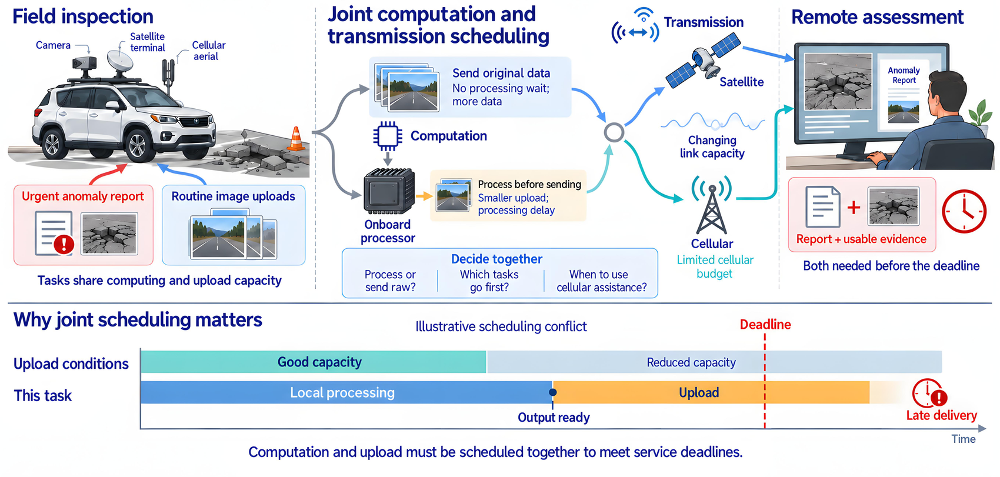
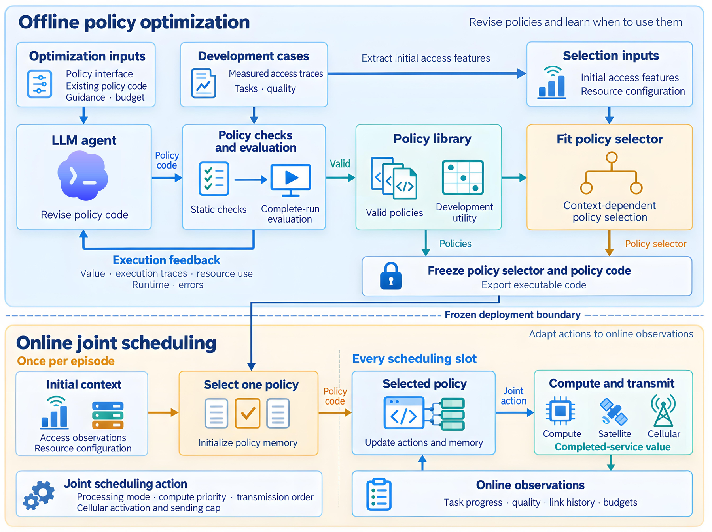
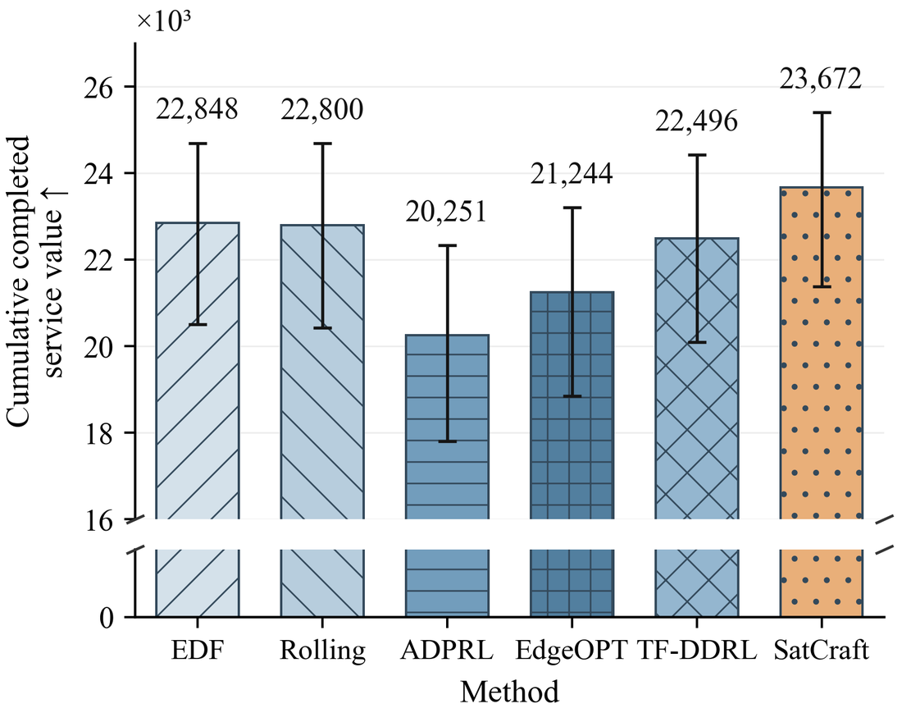

<div align="center">

# SatCraft

### Agentic Optimization of Scheduling Policies for Satellite–Cellular Edge Services

**Execution-feedback-driven policy optimization and a lightweight service simulator.**

[](https://arxiv.org/abs/2610.29588)
[](pyproject.toml)
[](LICENSE)
[](https://github.com/luopeng69131/SatCraft/actions/workflows/checks.yml)

**English** · [简体中文](README_zh-CN.md)

[Simulator](#satellitecellular-service-simulator) · [Quick start](#quick-start) · [Method](#how-satcraft-works) · [Citation](#citation)

</div>


## Why joint scheduling?

An inspection vehicle collects observations and sends reports and supporting
evidence to a remote assessment service. Satellite access extends connectivity
across areas with intermittent cellular coverage; local processing can reduce
the amount of data sent over either link. A useful assessment requires the
right products, adequate quality, and delivery before a shared deadline.

These decisions interact. Processing saves transmission capacity but delays
output availability. Activating cellular access too early spends its allowance
while the output is still being computed. Spending the remaining capacity on
current tasks can leave later, more valuable services incomplete. **Joint
scheduling coordinates processing modes, computing priorities, transmission
order, and cellular use around complete service delivery.**

<p align="center">
  
</p>

The community implementation brings together the **LLM-agent method**, a
**trace-driven service simulator**, **20 prebuilt scheduling policies and their
selector**, generic measurement processing, and small runnable examples.

## Satellite–cellular service simulator

The simulator executes the coupled workflow from product arrival to service
completion. Its Python standard-library implementation supports:

- **Local computation and output timing:** raw transmission or processing into
  a smaller output, with explicit computing demand and output readiness.
- **Dual-access transmission:** time-varying satellite and cellular capacities
  serving a shared queue.
- **Cellular usage constraints:** startup delay, traffic allowance and active-slot budgets.
- **Quality-dependent workflows:** product dependencies, delivered quality,
  supplementary work, shared deadlines and service acceptance.
- **Step-wise and full-episode execution:** observations, actions, state updates,
  event traces and completed-service accounting.
- **Custom scenarios:** user-supplied capacity sequences, products, service
  predicates and resource settings.

[Simulator API and scenario guide →](docs/simulator.md) ·
[Transition code →](src/satcraft/environment)

## Quick start

**Requirements:** Linux and Python 3.10+.

```bash
git clone https://github.com/luopeng69131/SatCraft.git
cd SatCraft
python -m venv .venv
source .venv/bin/activate
python -m pip install -e .
satcraft demo
```

This runs the bundled SatCraft policy selector and policy library on a small
synthetic scenario. Outputs go to `outputs/demo/`. Use `satcraft demo --policy
seed` to explore the same environment with the compact starter policy.

```python
from satcraft.data.workload import demo_cases
from satcraft.policies.deployment import frozen_policy
from satcraft.simulator import replay

result, state = replay(demo_cases()[0], frozen_policy(), log=True)
print(result["service_value"], result["max_service_value"])
print(state.records[0])
```

For a scenario file and a policy of your own:

```bash
satcraft simulate --cases /path/to/scenarios.json   --policy /path/to/policy.py --trace --output outputs/simulation.json
```

## How SatCraft works

<p align="center">
  
</p>

1. **Revise policy code.** An LLM agent receives the scheduling interface,
   current policy, repair direction and execution feedback.
2. **Execute complete services.** Code checks and simulator runs expose the
   consequences for output timing, resource use, quality and service completion.
3. **Retain useful alternatives.** Valid policies enter a reusable library.
4. **Select and execute.** A shallow selector uses initial access observations
   and known resource conditions to choose a policy for the episode.

[Agent loop](src/satcraft/agent/optimize.py) ·
[Prompt templates](src/satcraft/agent/prompts/initial.md) ·
[Policy selector](src/satcraft/selection/tree.py) ·
[20 prebuilt policies](src/satcraft/policies/library)

### Connect an LLM agent

`CandidateProvider` supplies candidate code, a rationale and model-usage
records. `CommandProvider` connects a model client through a JSON interface;
[examples/model_client.py](examples/model_client.py) illustrates the client contract.

```bash
satcraft optimize --cases outputs/demo/cases.json   --seed-policy src/satcraft/policies/seed.py   --provider-config /path/to/llm_command.json   --submissions 6 --output outputs/policy-repair
```

To exercise submission, checks, retention and deployment export with a supplied
policy, run `satcraft demo --policy seed --repair-demo --output outputs/repair-demo`.

[Policy construction guide →](docs/optimization.md)

## Work with measured access traces

The trace reader processes locally supplied measurements from the
[NUWiNS measurement project](https://github.com/NUWiNS/sigmetrics26-exploring-the-5g-digital-divide-in-the-non-contiguous-us-leo-satellites-to-the-rescue),
associated with *Exploring the 5G Digital Divide in the Non-Contiguous US:
LEO Satellites to the Rescue?* ([ACM](https://doi.org/10.1145/3771568)).
The Alaska and Maui campaigns collected paired Starlink/cellular measurements
in June and August 2024, respectively.

```bash
satcraft prepare --dataset-root /path/to/nuwins/datasets   --region alaska --carrier att --output /path/to/processed-traces
```

The processor preserves run and gap boundaries and exports paired capacities
with source metadata. Combine those capacities with your service workloads
through `make_case`. The [data guide](docs/data.md) documents input fields,
slot conversion and source attribution. Measurements are obtained from the
original authors under their **CC BY 4.0** release.

## Results in the paper

The paper reports completed-service-value gains of **3.61%–16.89%** over the
compared methods using measured Starlink and cellular access.

<p align="center">
  
</p>

[Reported results →](docs/results.md) · [Read the paper →](https://arxiv.org/abs/2610.29588)

## Code map

| Module | Purpose |
| --- | --- |
| [`simulator.py`](src/satcraft/simulator.py) | Public simulation entry points |
| [`environment/`](src/satcraft/environment) | Computing, radio, transmission and service transitions |
| [`agent/`](src/satcraft/agent) | Candidate providers, prompts and feedback-driven policy construction |
| [`policies/`](src/satcraft/policies) | Prebuilt policies, library management and deployment |
| [`selection/`](src/satcraft/selection) | Initial access features and utility-based selection |
| [`data/`](src/satcraft/data) | Trace processing, custom scenario builder and synthetic example |
| [`evaluation/`](src/satcraft/evaluation) | Policy checks, execution budgets and full-run feedback |

## License and acknowledgments

SatCraft code is released under the [MIT License](LICENSE). The linked NUWiNS
measurements carry their original CC BY 4.0 license and attribution;
see [data attribution](docs/data.md#attribution-and-license).
We thank the measurement authors for making their traces available.

## Citation

```bibtex
@misc{luo2026satcraft,
  title={SatCraft: Agentic Optimization of Scheduling Policies for Satellite-Cellular Edge Services},
  author={Pengcheng Luo and Dengke Deng and Zenghui Zhang and Genke Yang and Jian Chu},
  year={2026},
  eprint={2610.29588},
  archivePrefix={arXiv},
  primaryClass={eess.SY},
  doi={10.48550/arXiv.2610.29588},
  url={https://arxiv.org/abs/2610.29588}
}
```
