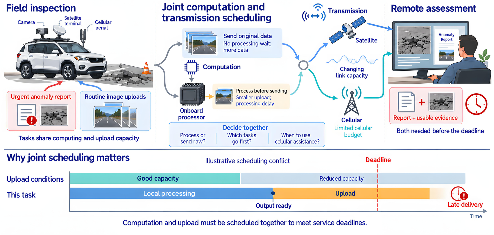
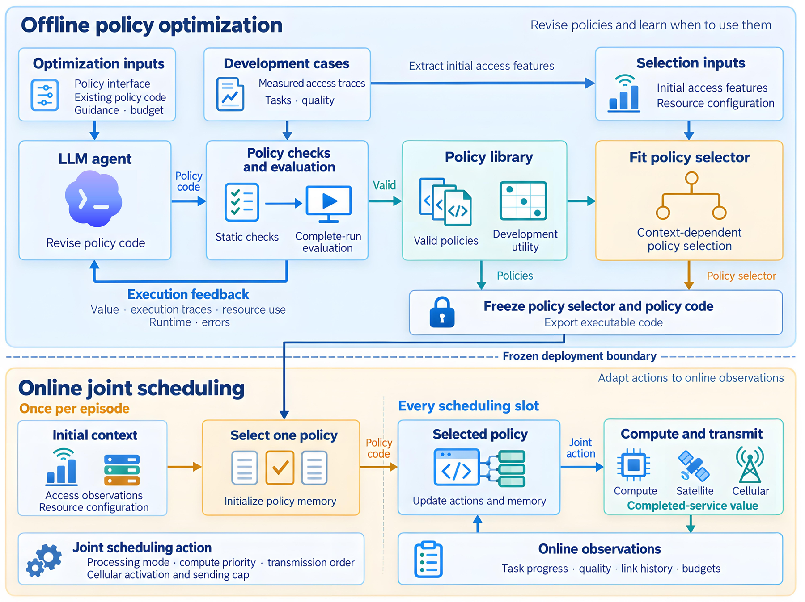
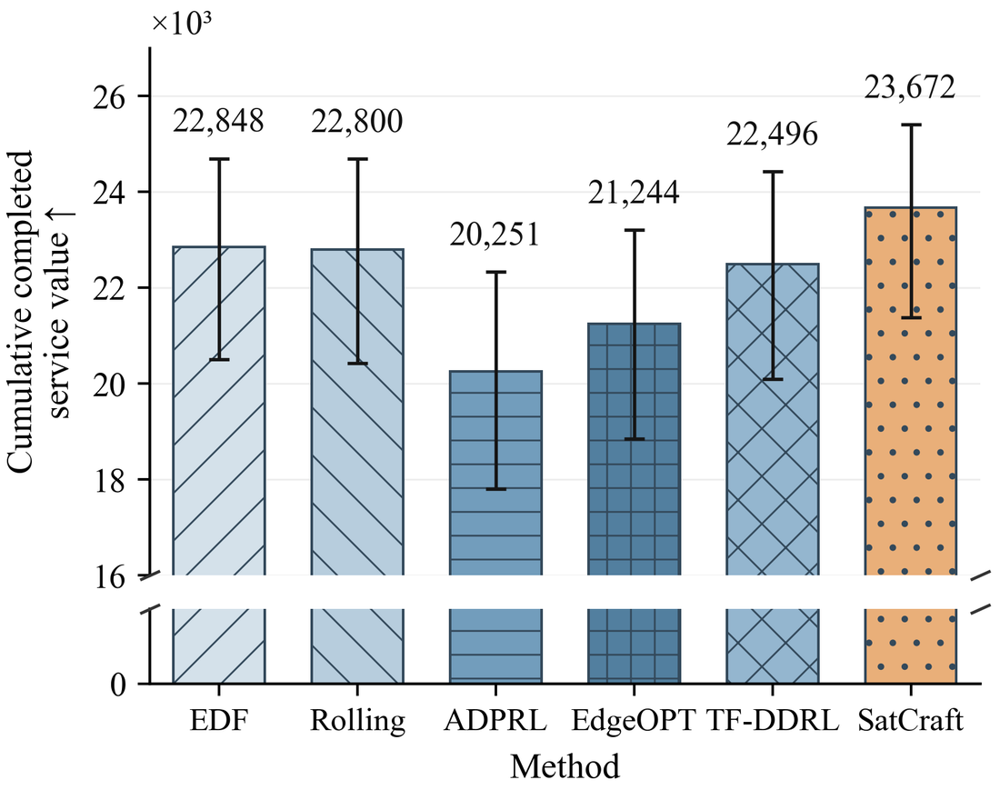

<div align="center">

# SatCraft

### 面向卫星与蜂窝边缘服务的 Agent 调度策略优化

**根据完整执行反馈改进调度策略，并提供轻量的服务级仿真器。**

[](https://arxiv.org/abs/2610.29588)
[](pyproject.toml)
[](LICENSE)
[](https://github.com/luopeng69131/SatCraft/actions/workflows/checks.yml)

[English](README.md) · **简体中文**

[论文](https://arxiv.org/abs/2610.29588) · [仿真器](#卫星与蜂窝服务仿真器) · [快速开始](#快速开始) · [方法](#satcraft-如何工作) · [引用](#引用)

</div>

## 论文

**[SatCraft: Agentic Optimization of Scheduling Policies for Satellite-Cellular Edge Services](https://arxiv.org/abs/2610.29588)**<br>
Pengcheng Luo, Dengke Deng, Zenghui Zhang, Genke Yang, and Jian Chu<br>
arXiv:2610.29588，2026 · [PDF](https://arxiv.org/pdf/2610.29588) · [DOI](https://doi.org/10.48550/arXiv.2610.29588)

## 为什么需要联合调度？

巡检车持续采集观测，向远端评估服务提交报告和佐证材料。卫星接入扩大蜂窝覆盖不连续区域的连接范围；本地处理可以减少传输数据量。一次有效评估需要相关产物满足质量要求，并在共同截止期前送达。

这些决策相互影响：本地处理节省传输容量，却推迟输出就绪时间；过早启用蜂窝会在等待计算输出时消耗启用额度；当前任务用尽资源，又可能让后续高价值服务无法完成。**联合调度需要围绕完整服务交付，协调处理模式、计算优先级、传输顺序和蜂窝使用。**

<p align="center">
  
</p>

公开实现提供**基于大语言模型的 Agent（LLM agent）方法骨架、轨迹驱动的服务仿真器、20 个可直接运行的冻结策略及选择器**，以及通用测量处理工具和小型示例。

## 卫星与蜂窝服务仿真器

仿真器描述从任务到达到完整服务交付的过程，使用 Python 标准库实现，支持：

- **本地计算与输出时序**：直接发送原始数据，或占用计算资源生成更小的输出。
- **双链路传输**：变化的卫星与蜂窝容量共同服务传输队列。
- **蜂窝使用约束**：启动延迟、流量额度与激活时隙预算。
- **质量相关任务流**：任务依赖、交付质量、补充任务、共同截止期与服务验收。
- **逐步和完整执行**：观测、联合动作、状态更新、事件轨迹和完成服务价值。
- **自定义场景**：接入用户指定的容量序列、任务、服务条件和资源设置。

[仿真接口与场景指南 →](docs/simulator.md) · [状态转移实现 →](src/satcraft/environment)

## 快速开始

**环境要求：**Linux、Python 3.10+。

```bash
git clone https://github.com/luopeng69131/SatCraft.git
cd SatCraft
python -m venv .venv
source .venv/bin/activate
python -m pip install -e .
satcraft demo
```

该命令在小型合成场景中运行随包提供的 SatCraft 选择器和策略库，输出位于 `outputs/demo/`。运行 `satcraft demo --policy seed` 可使用简短的起始策略体验同一环境。

```python
from satcraft.data.workload import demo_cases
from satcraft.policies.deployment import frozen_policy
from satcraft.simulator import replay

result, state = replay(demo_cases()[0], frozen_policy(), log=True)
print(result["service_value"], result["max_service_value"])
print(state.records[0])
```

运行自己的场景与策略：

```bash
satcraft simulate --cases /path/to/scenarios.json   --policy /path/to/policy.py --trace --output outputs/simulation.json
```

## SatCraft 如何工作

<p align="center">
  
</p>

1. **修改策略代码**：LLM agent 接收调度接口、已有程序、修复方向和执行反馈。
2. **执行完整服务**：代码检查与仿真揭示输出时序、资源用量、质量和服务完成结果。
3. **保留有效备选**：有效程序进入可复用的策略库。
4. **选择并执行**：浅层选择器根据初始接入观测和已知资源条件，为当前场景选定策略。

[Agent 闭环](src/satcraft/agent/optimize.py) · [提示词](src/satcraft/agent/prompts/initial.md) · [策略选择](src/satcraft/selection/tree.py) · [20 个冻结策略](src/satcraft/policies/library)

### 接入 LLM agent

`CandidateProvider` 提供候选代码、修改理由和模型用量；`CommandProvider` 通过 JSON 接口连接模型客户端。[examples/model_client.py](examples/model_client.py) 给出客户端约定。

```bash
satcraft optimize --cases outputs/demo/cases.json   --seed-policy src/satcraft/policies/seed.py   --provider-config /path/to/llm_command.json   --submissions 6 --output outputs/policy-repair
```

使用已有策略体验提交、检查、保留和部署导出：
`satcraft demo --policy seed --repair-demo --output outputs/repair-demo`。

[策略构建指南 →](docs/optimization.md)

## 使用测量轨迹

读取器处理用户从 [NUWiNS 测量项目](https://github.com/NUWiNS/sigmetrics26-exploring-the-5g-digital-divide-in-the-non-contiguous-us-leo-satellites-to-the-rescue)获取的本地数据，原论文为 *Exploring the 5G Digital Divide in the Non-Contiguous US: LEO Satellites to the Rescue?*（[ACM](https://doi.org/10.1145/3771568)）。其中，阿拉斯加与 Maui 道路测量分别采集于 2024 年 6 月和 8 月。

```bash
satcraft prepare --dataset-root /path/to/nuwins/datasets   --region alaska --carrier att --output /path/to/processed-traces
```

处理流程保留运行与间断边界，输出配对容量及来源信息；通过 `make_case` 将容量序列与自己的任务负载组合。[数据指南](docs/data.md)说明输入字段、时隙换算与数据归属。测量数据从原作者的 **CC BY 4.0** 发布渠道获取。

## 论文结果

论文使用实测 Starlink 与蜂窝接入，报告累计完成服务价值相对所比较方法提高 **3.61%–16.89%**。

<p align="center">
  
</p>

[结果概述 →](docs/results.md) · [阅读论文 →](https://arxiv.org/abs/2610.29588)

## 代码导航

| 模块 | 作用 |
| --- | --- |
| [`simulator.py`](src/satcraft/simulator.py) | 仿真公共入口 |
| [`environment/`](src/satcraft/environment) | 计算、无线、传输与服务状态转移 |
| [`agent/`](src/satcraft/agent) | 模型客户端、提示词与反馈驱动的策略构建 |
| [`policies/`](src/satcraft/policies) | 冻结策略、策略库管理与部署执行 |
| [`selection/`](src/satcraft/selection) | 初始接入特征与效用选择 |
| [`data/`](src/satcraft/data) | 轨迹处理、自定义场景构建与合成示例 |
| [`evaluation/`](src/satcraft/evaluation) | 策略检查、执行预算与完整运行反馈 |

## 引用

```bibtex
@misc{luo2026satcraft,
  title={SatCraft: Agentic Optimization of Scheduling Policies for Satellite-Cellular Edge Services},
  author={Pengcheng Luo and Dengke Deng and Zenghui Zhang and Genke Yang and Jian Chu},
  year={2026},
  eprint={2610.29588},
  archivePrefix={arXiv},
  primaryClass={eess.SY},
  doi={10.48550/arXiv.2610.29588},
  url={https://arxiv.org/abs/2610.29588}
}
```

## 许可与致谢

SatCraft 代码采用 [MIT License](LICENSE)。NUWiNS 测量数据遵循原始 CC BY 4.0 许可与署名要求，详见[数据归属说明](docs/data.md#attribution-and-license)。感谢原测量作者开放轨迹数据。
