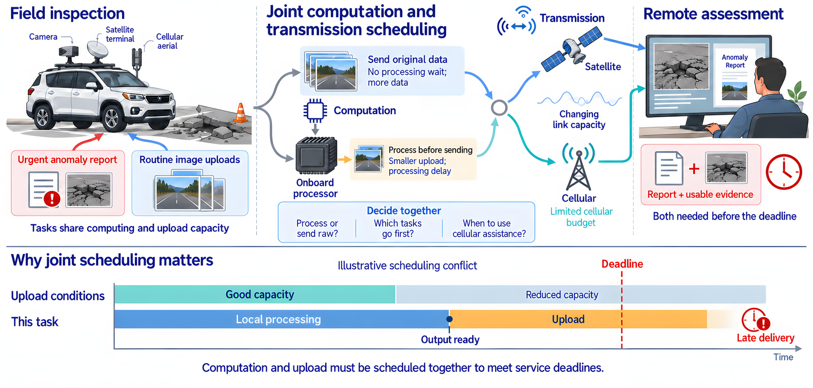
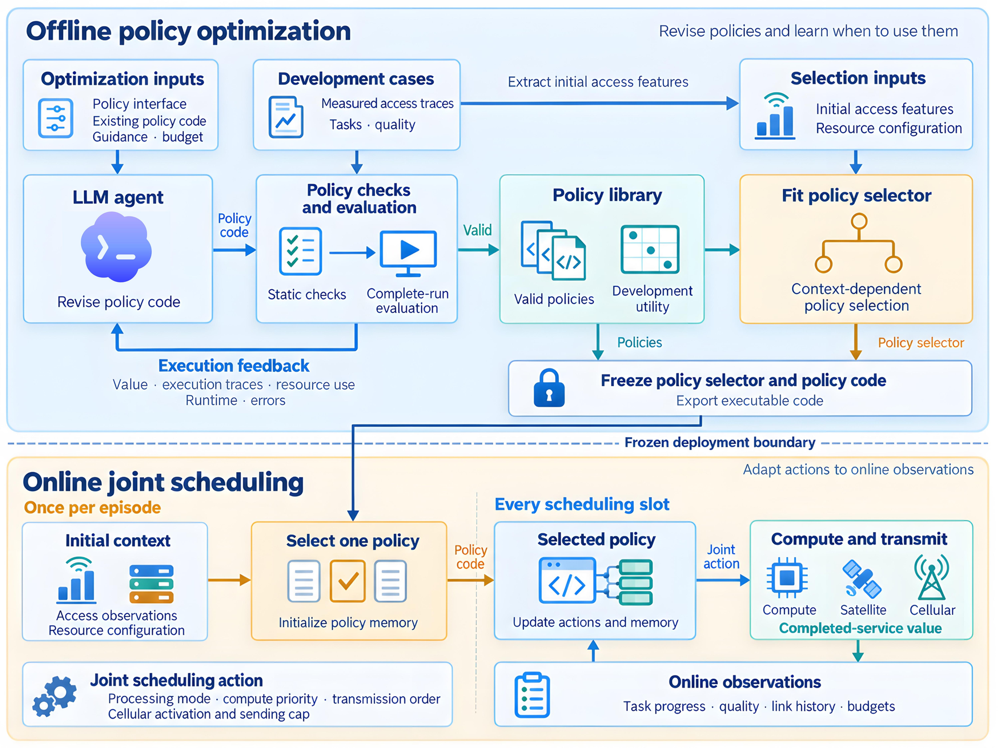
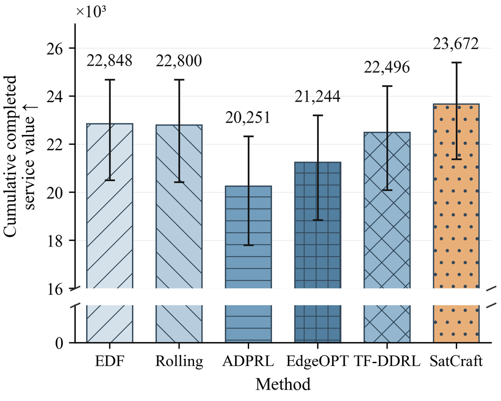

<div align="center">

# SatCraft

### 面向卫星与蜂窝边缘服务的 Agent 调度策略优化

**从完整服务的执行反馈中改进计算与传输联合调度策略。**

[](pyproject.toml)
[](LICENSE)
[](https://github.com/luopeng69131/SatCraft/actions/workflows/checks.yml)

[English](README.md) · **简体中文**

[问题背景](#为什么需要联合调度) · [方法概览](#satcraft-如何工作) · [快速开始](#快速开始) · [测量数据](#使用-starlink-与蜂窝测量数据) · [代码指南](docs/architecture.md)

</div>

## 为什么需要联合调度？

一辆巡检车持续采集观测，并向远端评估服务提交报告和佐证材料。卫星接入扩大了蜂窝覆盖不连续区域的连接范围；本地处理则能减少需要传输的数据量。一次有效的评估需要相关产物满足质量要求，并在共同截止期前送达。

这些决策相互影响：本地处理节省传输容量，却推迟输出就绪时间；过早启用蜂窝会在等待计算输出时消耗启用额度；当前任务用尽资源，又可能让后续高价值服务无法完成。**联合调度需要围绕完整服务交付，协调处理模式、计算优先级、传输顺序和蜂窝使用。**

<p align="center">
  
</p>

SatCraft 使用**基于大语言模型的 Agent（LLM agent）**，根据完整执行反馈修改可执行调度策略。系统保留有效策略，并根据初始接入观测和已知资源条件学习如何选择，让策略代码的改进作用于服务交付质量和及时性。

## SatCraft 如何工作

<p align="center">
  
</p>

1. **修改策略代码**：将调度接口、已有策略、修复方向和执行反馈交给 LLM agent。
2. **评价完整服务**：检查候选代码并完整回放场景，记录完成价值、资源用量、执行时间与事件。
3. **积累策略库**：保留满足有效性和执行预算的候选，形成适合不同条件的策略备选。
4. **选择并执行**：使用初始接入特征拟合浅层效用树，为一个场景选择一个策略；策略随后根据任务进度和已揭示质量持续更新动作与记忆。

**核心入口：**[修复闭环](src/satcraft/agent/optimize.py) · [提示词](src/satcraft/agent/prompts/initial.md) · [完整执行评价](src/satcraft/evaluation/replay.py) · [策略选择](src/satcraft/selection/tree.py) · [20 个冻结策略](src/satcraft/policies/library)

## 快速开始

**环境要求：**Linux、Python 3.10+。调度与数据处理包使用 Python 标准库。

```bash
git clone https://github.com/luopeng69131/SatCraft.git
cd SatCraft
python -m venv .venv
source .venv/bin/activate
python -m pip install -e .
satcraft demo
```

示例通过程序生成接入序列和具有依赖关系的服务负载，在四种资源配置下运行冻结的 SatCraft 策略。结果写入 `outputs/demo/evaluation.json`。

最小 Python 调用：

```python
from satcraft.data.workload import demo_cases
from satcraft.evaluation.replay import replay
from satcraft.policies.deployment import frozen_policy

result, state = replay(demo_cases()[0], frozen_policy())
print(result["service_value"], result["max_service_value"])
```

使用已有候选代码体验检查、完整执行反馈、策略保留、选择器拟合和部署导出：

```bash
satcraft demo --repair-demo --output outputs/repair-demo
```

### 接入 LLM agent

优化器提供 `CandidateProvider` 接口。`CommandProvider` 把修复提示词交给配置的模型客户端，并以 JSON 接收策略代码、修改理由和模型用量。可从 [examples/model_client.py](examples/model_client.py) 接入客户端，并在[配置文件](configs/llm_command.example.json)中指定其命令。

```bash
satcraft optimize \
  --cases /path/to/processed/development.json \
  --seed-policy src/satcraft/policies/seed.py \
  --provider-config /path/to/llm_command.json \
  --submissions 6 \
  --output outputs/policy-repair
```

[策略优化指南 →](docs/optimization.md)

## 使用 Starlink 与蜂窝测量数据

SatCraft 处理 [NUWiNS 测量项目](https://github.com/NUWiNS/sigmetrics26-exploring-the-5g-digital-divide-in-the-non-contiguous-us-leo-satellites-to-the-rescue)发布的同步接入测量，原工作为 *Exploring the 5G Digital Divide in the Non-Contiguous US: LEO Satellites to the Rescue?*（[ACM](https://doi.org/10.1145/3771568)）。

| 测量活动 | 采集时间 | SatCraft 使用的接入配对 |
| --- | --- | --- |
| 阿拉斯加道路测量 | 2024 年 6 月 | Starlink + AT&T / Verizon |
| 夏威夷 Maui 道路测量 | 2024 年 8 月 | Starlink + AT&T / Verizon |

从原项目下载 processed 压缩包，解压到本地数据目录。处理流程读取配对吞吐量样本、保留测量运行和间断边界，聚合成标称一秒时隙，并生成计算任务与质量相关服务约束。

```bash
satcraft prepare \
  --dataset-root /path/to/nuwins/datasets \
  --source-manifest configs/measurement_sources.json \
  --output /path/to/processed

satcraft evaluate \
  --cases /path/to/processed/test.json \
  --output outputs/test-results.json
```

来源索引定位 60 条测量轨迹，处理后得到 360 个开发案例、240 个验证案例和 360 个测试案例。测得的下行吞吐量提供外生链路容量序列；负载生成器提供计算需求、服务依赖和处理后质量。初始八个时隙的接入观测用于策略选择。

**数据归属：**原始测量由 Sizhe Wang 等作者以 **CC BY 4.0** 许可发布。[数据指南](docs/data.md)列出来源链接、作者、输入字段与处理步骤。

## 主要实验结果

在已有的轨迹驱动实验中，SatCraft 在所比较的方法中取得最高累计完成服务价值，相对增益为 **3.61%–16.89%**。测试集包含 360 个案例，覆盖变化的 Starlink 与蜂窝接入和四种资源配置。

<p align="center">
  
</p>

| 方法 | 累计完成服务价值 ↑ |
| --- | ---: |
| EDF | 22,848 |
| Rolling | 22,800 |
| ADPRL | 20,251 |
| EdgeOPT | 21,244 |
| TF-DDRL | 22,496 |
| **SatCraft** | **23,672** |

表中数值取整；学习策略的结果为所评价训练种子的均值。[结果说明](docs/results.md)介绍指标定义和评价配置。

## 代码导航

| 模块 | 作用 |
| --- | --- |
| [`agent/`](src/satcraft/agent) | 有界策略修复、提示词、模型客户端接口和用量账本 |
| [`evaluation/`](src/satcraft/evaluation) | 代码检查、完整执行、反馈与执行预算 |
| [`policies/`](src/satcraft/policies) | 策略库、冻结策略、场景级选择与执行 |
| [`selection/`](src/satcraft/selection) | 初始接入特征与效用树拟合 |
| [`environment/`](src/satcraft/environment) | 计算、双接入传输、产物依赖与服务验收 |
| [`data/`](src/satcraft/data) | 测量读取、来源选择与负载生成 |

## 扩展 SatCraft

- **新增负载**：通过案例结构定义产物依赖、质量条件、截止期与服务价值。
- **新增策略**：实现 `policy(observation, memory)`，使用 `satcraft evaluate --policy path/to/policy.py` 检查完整服务结果。
- **新增模型客户端**：实现 `CandidateProvider.propose`，或通过 `CommandProvider` 接入命令。

[系统结构](docs/architecture.md) · [数据处理](docs/data.md) · [策略优化](docs/optimization.md)

## 许可与致谢

SatCraft 代码采用 [MIT License](LICENSE)。链接的 NUWiNS 测量数据遵循原始 **CC BY 4.0** 许可与署名要求，详见[数据归属说明](docs/data.md#attribution-and-license)。感谢原测量作者向社区开放轨迹数据。
