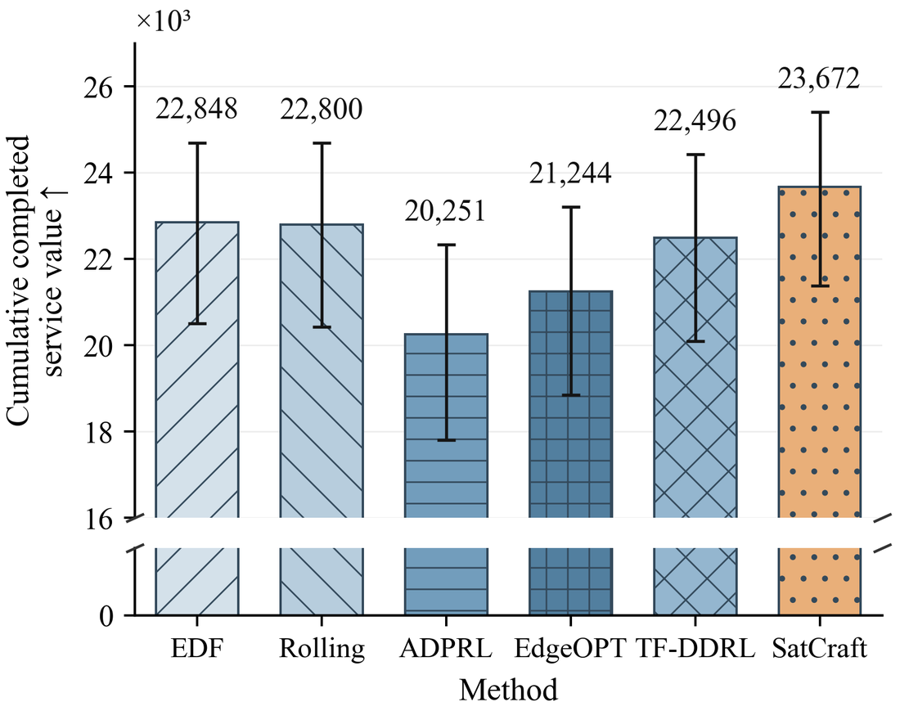

# Results reported in the paper

The [SatCraft paper](https://arxiv.org/abs/2610.29588) evaluates joint scheduling
using measured Starlink and cellular capacities and modeled service workloads.
The primary metric is cumulative completed-service value: a service contributes
only when its quality and delivery conditions hold by its deadline.

| Method | Completed-service value ↑ |
| --- | ---: |
| EDF | 22,848 |
| Rolling | 22,800 |
| ADPRL | 20,251 |
| EdgeOPT | 21,244 |
| TF-DDRL | 22,496 |
| **SatCraft** | **23,672** |

The reported gains range from 3.61% to 16.89% across the compared methods.
Values are displayed as integers; learned-policy results average the evaluated
training seeds. The paper also examines resource pressure, policy construction,
selection, execution costs and the mechanisms behind scheduling changes.

[Paper](https://arxiv.org/abs/2610.29588) · [PDF](https://arxiv.org/pdf/2610.29588)
